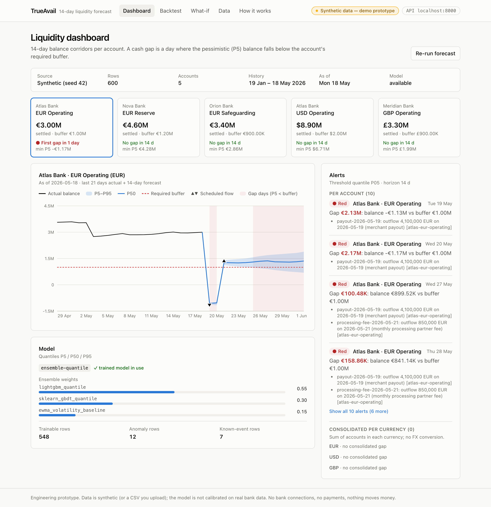
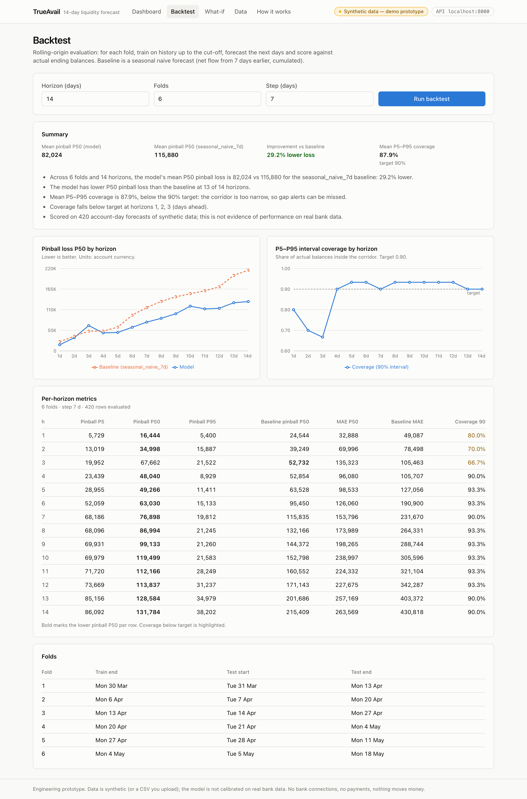
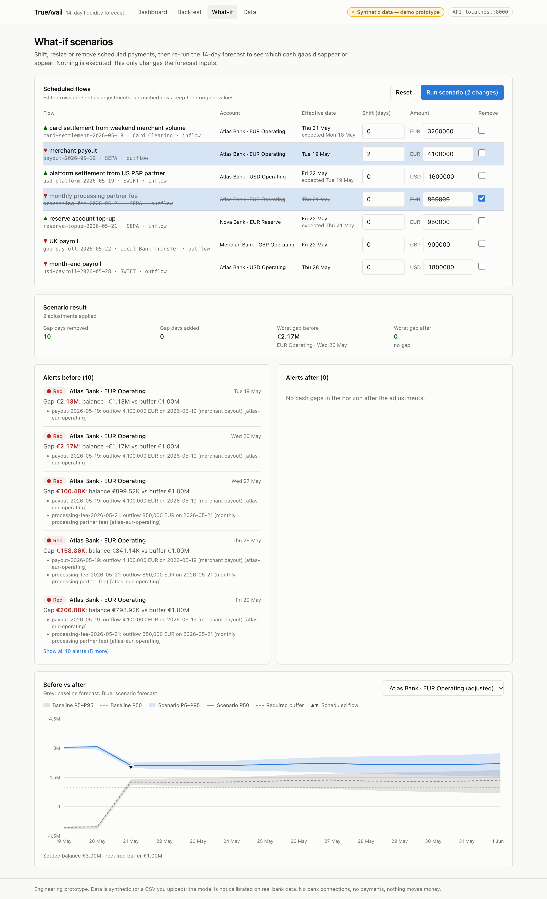

# TrueAvail — 14-day liquidity forecasting prototype

TrueAvail forecasts the next 14 days of account balances for a company with several bank accounts and currencies, and flags **cash gaps**: days on which the pessimistic balance falls below the account's required buffer. Instead of a single number it produces a quantile corridor (P5 / P50 / P95), so the downside is visible before it happens.



> **Scope.** Data is synthetic (5 accounts × 120 days = 600 daily observations, reproducible seed) or a CSV you upload in the same format. The model is not calibrated on real bank data, there are no bank connections, and nothing moves money. The project started as a team entry at the NIS SynergyX Hackathon (May 2026, 1st place, FinTech & Business Solutions track); that version is preserved in tag [`hackathon-may-2026`](../../tree/hackathon-may-2026). This branch is the engineering rebuild.

## What it does

| Feature | Where |
|---|---|
| 14-day P5/P50/P95 balance forecast per account: LightGBM quantile + scikit-learn gradient boosting + EWMA baseline, weighted ensemble | `backend/trueavail/forecasting.py` |
| Features: calendar and holidays, lags (1/2/7 days), 7-day rolling mean and volatility, EWMA, MAD anomaly score, known scheduled flows with settlement delays per payment rail | `features.py`, `settlement.py` |
| Cash-gap alerts per account and consolidated per currency (no FX conversion), severity and driving scheduled flows | `alerts.py` |
| Rolling-origin backtest against a seasonal-naive (7-day) baseline: pinball loss per quantile and horizon, 90 % interval coverage, MAE | `backtest.py` |
| What-if: shift, resize, remove or add a scheduled payment and see which gaps disappear or appear | `whatif.py` |
| Synthetic data generator and CSV upload with row-level validation | `data.py` |
| Datasets, scheduled flows and forecast runs stored in PostgreSQL (SQLite for tests) | `db.py` |
| Stress scenarios and a PuLP/HiGHS rebalancing optimizer (secondary, kept from the hackathon version) | `stress.py`, `optimizer.py` |
| Next.js dashboard: fan chart, alerts, backtest, what-if and data pages | `frontend/` |

## Run it

Requires Docker.

```bash
docker compose up --build
```

- Dashboard: http://localhost:3000
- API and interactive docs: http://localhost:8000/docs

The first start creates the default synthetic dataset (seed 42) in PostgreSQL.

Without Docker (Python 3.12+, Node 22+):

```bash
make venv          # backend virtualenv
make test          # backend test suite
make backtest      # backtest on the default dataset
make dev           # backend :8000 + frontend :3000 (SQLite)
```

## Backtest results (default synthetic dataset)

6 folds, 7-day step, 14-day horizon, 420 scored points, about 3 s on a laptop. Units are account currency, averaged across accounts. Regenerate with `make backtest`.

| | Model (P50) | Seasonal-naive baseline |
|---|---|---|
| Mean pinball loss | 82,024 | 115,880 |
| Improvement | **29.2 %** | — |
| Mean 90 % interval coverage (target 0.90) | 0.879 | — |

By horizon:

| h (days) | 1 | 2 | 3 | 4 | 5 | 7 | 10 | 14 |
|---|---|---|---|---|---|---|---|---|
| Pinball P50, model | 16.4k | 35.0k | 67.7k | 48.0k | 49.3k | 76.9k | 119.5k | 131.8k |
| Pinball P50, baseline | 24.5k | 39.2k | **52.7k** | 52.9k | 63.5k | 115.8k | 152.8k | 215.4k |
| Coverage 90 % | 0.80 | 0.70 | 0.67 | 0.90 | 0.93 | 0.90 | 0.93 | 0.90 |

Known weaknesses, visible in the numbers above:
- At h = 3 the model is worse than the baseline.
- Intervals are too narrow for h = 1–3 (coverage 0.67–0.80 against a 0.90 target); from h = 4 coverage is on target.
- The backtest scores the model on history only; scheduled flows are not replayed.
- Synthetic data is generated by a known process, so these numbers describe the method, not real-world accuracy.



## What-if

Shift the EUR 4.1M merchant payout by two days and remove a fee: the scenario removes 10 gap-days on the Atlas EUR account.



## API

| Method | Path | Purpose |
|---|---|---|
| GET | `/health` | status, model availability, active dataset, database type |
| GET | `/api/accounts` | accounts of the active dataset |
| POST | `/api/data/generate` | new synthetic dataset (`accounts`, `history_days`, `seed`) |
| POST | `/api/data/upload` | upload history CSV (+ optional scheduled flows CSV); 422 with row-level errors |
| GET | `/api/data/history`, `/api/data/scheduled` | active dataset rows |
| GET | `/api/data/samples/{name}` | sample CSVs in the expected format |
| POST | `/api/forecast/run` | 14-day quantile forecast |
| GET | `/api/forecast/runs` | stored forecast runs |
| GET | `/api/alerts` | cash-gap alerts per account and per currency |
| POST | `/api/backtest/run` | rolling-origin backtest |
| POST | `/api/whatif/run` | before/after forecast and alerts for adjusted scheduled flows |
| POST | `/api/stress/run`, `/api/optimizer/rebalance` | stress scenarios, rebalancing optimizer |

Full contract: [`docs/SPEC.md`](docs/SPEC.md). OpenAPI at `/docs` when the backend runs.

## Data format

History CSV, one row per account per day:

```
date,account_id,bank_name,currency,net_flow,ending_balance,required_buffer
```

Scheduled flows CSV:

```
flow_id,account_id,currency,amount,direction,expected_date,rail,description
```

Samples: [`backend/data/samples/`](backend/data/samples/).

## Repository layout

```
backend/    FastAPI app, ML pipeline, tests (pytest), Dockerfile
frontend/   Next.js + TypeScript + Tailwind + recharts, Dockerfile
docs/       SPEC.md
docker-compose.yml   PostgreSQL 16 + backend + frontend
.github/workflows/   CI: backend tests, frontend lint/type-check/build, docker build
```

## Stack

Python 3.12, FastAPI, pandas, LightGBM, scikit-learn, PuLP/HiGHS, SQLAlchemy, PostgreSQL · Next.js, TypeScript, Tailwind CSS, recharts · Docker Compose, GitHub Actions.
