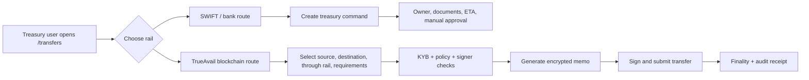

# Transfer Rail MVP Living Plan

Status: MVP mock implementation in progress  
Owner: TrueAvail treasury transfer module  
Rule: before changing the transfer system, reread this file and update the relevant checklist item or decision note.

## 1. Goal

Build a pitch-ready transfer system where a treasury user chooses one of two rails:

1. **SWIFT / bank route**: the system does not pretend to move money instantly. It creates a governed treasury command for the treasury team, with cut-off risk, documents, approvals, owner, ETA, and manual execution status.
2. **TrueAvail blockchain route**: the user selects source account, destination account, settlement path, and extra requirements. The system runs KYB/policy checks, generates an encrypted compliance memo, signs/submits a transfer, shows live finality, and produces an audit/compliance view.

The MVP must sell the contrast:

- SWIFT is familiar but slow, operational, and document-heavy.
- TrueAvail blockchain rail is fast, private by default, compliance-readable by permission, and still governed.

## 2. Product Boundary

This is an MVP demo, not a production banking system.

In scope:

- UI for choosing `SWIFT` or `TrueAvail Blockchain`.
- Happy-path internal transfer between two trusted company accounts.
- Mocked treasury command for SWIFT.
- Mocked encrypted compliance memo for blockchain.
- Optional smart-contract scaffold for zkSync Era Sepolia.
- Compliance/auditor screen that decrypts or reveals the transfer memo with a view key.
- Animated transfer progress track already introduced on `/transfers`.

Out of scope for MVP:

- Real bank API execution.
- Real legal-grade FX control workflow.
- Production zero-knowledge circuits.
- Custody, key recovery, multisig production policy.
- Real stablecoin liquidity management.

## 3. Existing Project Context

Current relevant files:

- `app/transfers/page.tsx`: current transfers route.
- `components/liquidity/FundTransfersView.tsx`: current transfer visualization page.
- `app/globals.css`: current styling for transfer page and blockchain flow.
- `lib/permissioned-rail.ts`: existing permissioned-rail model language.
- `lib/blockchain-transfer-model.ts`: older public-chain router model; keep only as supporting research or replace in primary UI.
- `lib/i18n.ts`: shared EN/RU translation map.
- `components/liquidity/DemoNav.tsx`: nav entry for `/transfers`.

Implementation rule: keep `/transfers` as the main treasury operator screen. Add a separate compliance screen instead of overloading the operator screen.

Recommended new files:

- `docs/transfer-rail-mvp-plan.md`: this living plan.
- `lib/transfers/transfer-rail-types.ts`: shared TypeScript contracts.
- `lib/transfers/transfer-rail-fixtures.ts`: deterministic demo accounts, rails, policies, KYB states.
- `lib/treasury-ledger.ts`: single demo ledger for accounts, balances, usable liquidity, survival floors, wallets, KYB, conditions, and ledger movements.
- `app/api/treasury/accounts`: unified account read/write API used by map, transfers, and condition pages.
- `lib/transfers/encryption-demo.ts`: MVP-only encrypted memo helpers.
- `app/api/transfers/invoice/route.ts`: generate invoice/compliance memo.
- `app/api/transfers/swift-command/route.ts`: create treasury command for SWIFT.
- `app/api/transfers/blockchain-intent/route.ts`: prepare blockchain transfer intent.
- `app/transfers/compliance/page.tsx`: auditor/regulator view.
- `components/liquidity/transfers/*`: split large transfer UI into reusable rail selector, forms, progress, receipt, compliance panels.
- `contracts/IdentityRegistry.sol`: whitelist/KYB registry scaffold.
- `contracts/CorporateLiquidity.sol`: guarded transfer scaffold.
- `hardhat.config.ts`: only when contract work starts.

## 4. Page Architecture

The `/transfers` page should become an operator console with three visible zones:

1. **Rail choice**: segmented control with `SWIFT` and `TrueAvail Blockchain`.
2. **Transfer setup**: form changes depending on selected rail.
3. **Execution proof**: animated flow, policy checks, receipt, ETA/finality comparison.



## 5. User Flow: SWIFT

User selects `SWIFT`.

Required fields:

- From account.
- To account.
- Amount and currency.
- Purpose.
- Cut-off date/time.
- Treasury owner.
- Required documents: invoice, board approval, FX control package, tax support.

Behavior:

- No blockchain animation as if money settled instantly.
- Show a treasury-command pipeline:
  - request created;
  - documents attached;
  - treasury owner assigned;
  - manual bank instruction pending;
  - ETA `T+1 / T+2 / T+3`;
  - cut-off risk and fallback action.
- Output: `TreasuryCommandReceipt`.

Pitch message:

> SWIFT is still supported, but TrueAvail makes the delay, owner, paperwork, and operational risk explicit.

## 6. User Flow: TrueAvail Blockchain

User selects `TrueAvail Blockchain`.

Required fields:

- Source company account.
- Destination company account.
- Amount and currency.
- Through route:
  - `zkSync Era Sepolia`.
  - `Permissioned internal liquidity rail`.
  - `USDC test asset`.
  - `Native ETH mock` if stablecoin is not available.
- Additional requirements:
  - regulator-readable memo;
  - private market memo;
  - same-company KYB only;
  - signer quorum;
  - cut-off before time;
  - compliance report language.

Happy path:

1. Validate source and destination are allowlisted under the same company group.
2. Generate invoice/compliance JSON on API route.
3. Encrypt or hash the memo for public chain storage.
4. Submit transfer intent.
5. Animate:
   - KYB/policy check;
   - invoice hashing/encryption;
   - wallet signature;
   - zkSync confirmation;
   - finality receipt.
6. Show receipt:
   - tx hash or mock tx id;
   - encrypted memo hash;
   - policy version;
   - signer;
   - finality time;
   - compliance view link.

Pitch message:

> The market sees only transfer metadata and encrypted memo. The regulator, with the view key, sees the business reason and invoice details.

## 7. Compliance View

Route: `/transfers/compliance`

Purpose: make privacy and audit obvious to the jury.

UI:

- Transaction search by tx id/hash.
- View-key input.
- Public-chain preview:
  - from wallet;
  - to wallet;
  - amount;
  - encrypted memo.
- Decrypted compliance report:
  - company BIN/INN;
  - source legal entity;
  - destination legal entity;
  - amount;
  - date;
  - FX rate;
  - invoice number;
  - transfer purpose;
  - signer and policy version.

MVP security note:

- Do not claim production ZK.
- Say: `MVP simulates privacy with encrypted memo; production path uses zkSync/private execution patterns.`

## 8. Data Contracts

Use shared TypeScript types before building UI components.

```ts
export type TransferRail = "swift" | "blockchain";

export type TransferAccount = {
  id: string;
  label: string;
  legalEntity: string;
  jurisdiction: string;
  currency: "USD" | "EUR" | "KZT" | "AED";
  balance: number;
  walletAddress?: `0x${string}`;
  bankIban?: string;
  kybStatus: "approved" | "pending" | "blocked";
};

export type BlockchainRoute = {
  id: string;
  label: string;
  network: "zkSync Era Sepolia" | "Internal Permissioned Rail";
  asset: "USDC_TEST" | "ETH_MOCK";
  finalitySeconds: number;
  privacyMode: "encrypted_memo" | "hash_only";
};

export type TransferRequirements = {
  regulatorReadable: boolean;
  privateMarketMemo: boolean;
  signerQuorum: "1-of-1" | "2-of-2";
  requiredBefore: string;
  complianceLanguage: "en" | "ru";
};

export type TransferIntent = {
  rail: TransferRail;
  fromAccountId: string;
  toAccountId: string;
  amount: number;
  currency: string;
  purpose: string;
  routeId?: string;
  requirements: TransferRequirements;
};
```

## 8.1 Unified Treasury Ledger

All account-facing pages must read the same account record. Do not create one-off balances inside UI components.

Single source:

- `lib/treasury-ledger.ts` owns company accounts, balances, usable balances, floors, conditions, KYB state, wallet addresses, bank identifiers, and map coordinates.
- `lib/treasury-ledger-store.ts` persists the demo ledger into `.data/treasury-ledger.json` so API routes share one file-backed state during the pitch.
- `GET /api/treasury/accounts` returns the current ledger snapshot.
- `PATCH /api/treasury/accounts/:accountId` updates account balance or condition from the map cockpit.
- `POST /api/treasury/accounts` adds a new treasury node to the same ledger.

Rail behavior:

- Blockchain settlement updates source and destination balances immediately in the shared ledger.
- SWIFT creates a pending treasury command and keeps balances unchanged until manual settlement.
- Condition detail pages derive their KPIs and obligations from the ledger, not from separate fixtures.

Pitch rule:

> If the jury opens `/liquidity-control-tower`, `/liquidity-control-tower/conditions/:accountId`, `/transfers`, and `/transfers/compliance`, the account identity, balance, wallet, KYB state, and condition story must agree.

## 9. API Plan

### `POST /api/transfers/swift-command`

Input: `TransferIntent` with `rail: "swift"`.

Output:

- command id;
- assigned treasury owner;
- required documents;
- ETA;
- cut-off risk;
- status timeline.

### `POST /api/transfers/invoice`

Input: transfer details.

Output:

- invoice JSON;
- invoice id;
- normalized compliance fields;
- clear memo for local demo only.

### `POST /api/transfers/blockchain-intent`

Input: `TransferIntent` with `rail: "blockchain"`.

Output:

- policy check results;
- encrypted memo;
- memo hash;
- prepared contract call fields;
- mock tx id until Web3 is wired.

### `GET /api/transfers/compliance/:txId`

Input: tx id and view key.

Output:

- public transaction preview;
- decrypted report if view key is valid;
- rejection reason if invalid.

### `GET /api/treasury/accounts`

Output:

- current account list;
- current movement log;
- `source: "unified-treasury-ledger"`.

### `PATCH /api/treasury/accounts/:accountId`

Input:

- balance update;
- condition update.

Output:

- updated account record from the shared ledger.

## 10. Smart Contract MVP

Only start this after UI and mock API prove the flow.

### `IdentityRegistry.sol`

Responsibilities:

- Store allowlisted wallet address.
- Store company group id.
- Admin can add/remove wallets.
- Read function: `isApprovedForCompany(address wallet, bytes32 companyId)`.

### `CorporateLiquidity.sol`

Responsibilities:

- Accept `transferLiquidity(address to, uint256 amount, bytes32 encryptedMemo)`.
- Check `msg.sender` and `to` are both approved for the same company.
- Emit event with encrypted memo.
- Use native ETH mock first; add ERC20 later if needed.

Events:

```solidity
event LiquidityTransferred(
  address indexed from,
  address indexed to,
  uint256 amount,
  bytes32 indexed encryptedMemo,
  bytes32 companyId
);
```

Deployment target:

- First: local Hardhat.
- Then: zkSync Era Sepolia.

## 11. Frontend Implementation Phases

### Phase 1: Rail Selector and Forms

Tasks:

- Replace single blockchain-only hero flow with rail selector.
- Add SWIFT form and blockchain form.
- Keep existing animated blockchain track, but connect it to blockchain rail only.
- Show SWIFT treasury-command flow separately.

Done when:

- User can choose SWIFT or blockchain.
- Each rail shows different fields and different execution proof.
- No full build errors.

### Phase 2: Mock API and Receipts

Tasks:

- Add deterministic API routes.
- Generate `TreasuryCommandReceipt` for SWIFT.
- Generate `BlockchainTransferReceipt` for blockchain.
- Store latest demo transfer in client state or deterministic fixture.

Done when:

- Clicking submit produces a receipt.
- The receipt is readable for a pitch.
- Failure states are visible.

### Phase 3: Compliance View

Tasks:

- Add `/transfers/compliance`.
- Add tx id input and view key input.
- Show public encrypted memo first.
- Reveal decrypted compliance report after valid demo key.

Done when:

- Demo can show privacy contrast in under 30 seconds.

### Phase 4: Web3 Scaffold

Tasks:

- Install `wagmi`, `viem`, and Hardhat dependencies only when needed.
- Add contract ABIs.
- Add wallet connect/sign flow.
- Add local/mock mode fallback so demo works without MetaMask.

Done when:

- Mock mode still works.
- Wallet mode can prepare or submit a testnet transaction.

### Phase 5: zkSync Testnet

Tasks:

- Add zkSync Sepolia config.
- Deploy `IdentityRegistry`.
- Deploy `CorporateLiquidity`.
- Add env vars for contract addresses.
- Add deployment README section.

Done when:

- Contract interaction works in testnet or cleanly falls back to mock mode.

## 12. UI Rules

- Keep dark operational TrueAvail style.
- Avoid crypto-trader language.
- Say `permissioned blockchain rail`, `encrypted memo`, `compliance receipt`, `finality`.
- Do not say production ZK is already implemented unless contracts/proofs exist.
- The blockchain UI must show controls, not bypass controls.
- SWIFT must look supported, but slower and manual.

Required visible comparison:

| Rail | Speed | Privacy | Who acts | Proof |
|---|---:|---|---|---|
| SWIFT | T+1/T+3 | Bank/document process | Treasury team | Treasury command receipt |
| TrueAvail Blockchain | seconds/minutes | encrypted memo | Smart contract + signer | tx/finality/compliance receipt |

## 13. Demo Script

1. Open `/transfers`.
2. Select `SWIFT`.
3. Fill same internal transfer.
4. Submit and show treasury command: owner, documents, ETA, cut-off risk.
5. Switch to `TrueAvail Blockchain`.
6. Select source, destination, route, and compliance requirements.
7. Submit and show animated flow:
   - KYB;
   - encrypted invoice;
   - signature;
   - zkSync/finality;
   - receipt.
8. Open `/transfers/compliance`.
9. Show public transaction with encrypted memo.
10. Enter view key and reveal compliance report.

Closing line:

> Business gets speed and privacy. Compliance gets selective transparency and audit.

## 14. Risk Register

| Risk | Mitigation |
|---|---|
| Jury thinks this is speculative crypto | Frame as internal treasury rail and compliance-controlled liquidity movement. |
| Real zkSync setup takes too long | Keep mock mode as primary demo; add testnet only after UI/API work is stable. |
| Privacy claim sounds overstated | Use precise language: encrypted memo in MVP, ZK/private execution as production path. |
| SWIFT path feels like a dead button | Make it generate a rich treasury-command receipt. |
| Page gets too dense | Use rail selector and progressive disclosure. |

## 15. Verification Gates

Every implementation phase must run:

- `npm run lint`
- `npm run build`
- Browser QA for `/transfers`
- Browser QA for `/transfers/compliance` after that route exists
- Mobile viewport check
- RU/EN toggle check for user-facing copy

Before marking the transfer MVP complete:

- Run anti-slop pass against changed transfer files.
- Run code review pass.
- Update this plan with final implementation notes and any deviations.

## 16. Current Checklist

- [x] Create living Markdown plan.
- [x] Implement rail selector on `/transfers`.
- [x] Add SWIFT treasury-command flow.
- [x] Add blockchain setup form with source, destination, through route, requirements.
- [x] Add mock transfer API routes.
- [x] Add compliance/auditor view.
- [x] Add unified treasury ledger for balances, conditions, KYB, wallets, and cross-page account consistency.
- [x] Add treasury account API for map edits, account creation, and transfer balance refresh.
- [x] Add randomized map anomaly generator with fresh account conditions and ML telemetry.
- [ ] Split transfer page into smaller components.
- [x] Add contract scaffold.
- [ ] Add optional wagmi/viem integration.
- [x] Run final pitch QA.

## 17. Decision Log

### 2026-05-23

- The MVP will start with a deterministic mock mode so the pitch works without wallet, testnet, or third-party availability.
- The blockchain story is a controlled internal treasury rail, not a public-chain router for speculative settlement.
- The SWIFT path remains part of the product as a governed treasury command, not as a fake instant transfer.
- First implementation pass added deterministic API routes, rail selector UI, SWIFT treasury-command receipt, blockchain encrypted-memo receipt, `/transfers/compliance`, and Solidity contract scaffolds.
- Browser/API QA covered SWIFT command creation, blockchain finality receipt, compliance view reveal with demo key, desktop/mobile screenshots, and direct API calls.
- zkSync deployment and wallet integration remain a later phase because they require funded testnet credentials and should not block the pitch-safe mock flow.
- Unified ledger pass connected `/transfers`, `/transfers/compliance`, `/liquidity-control-tower`, and condition pages to one account source. Blockchain mock settlement now changes ledger balances; SWIFT creates a pending command without fake instant settlement.
- Store hardening pass added `.data/treasury-ledger.json` file-backed state via `lib/treasury-ledger-store.ts`, avoiding separate server/client memory stories during QA.
- Map anomaly pass replaced the static New York-only demo with generated treasury conditions, random target accounts, randomized settlement telemetry, and an ML ensemble report that recalculates verdict, risk score, confidence, evidence, and recommendations from each generated incident.
